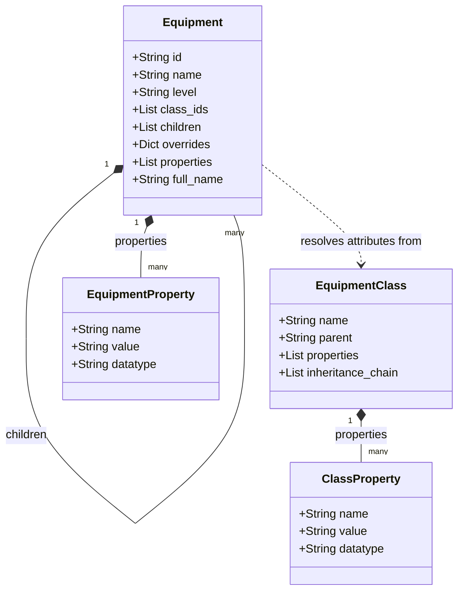
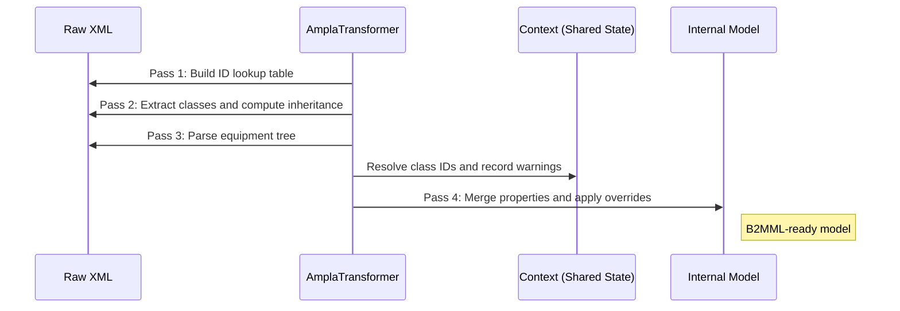

# Ampla to B2MML Transformer

The Ampla to B2MML Transformer converts an Ampla Project XML export into an ISA-95 B2MML Equipment model.

It uses Python to provide a command-line tool, a FastAPI service, and several export formats. Its multi-pass pipeline supports equipment hierarchies, class inheritance, and property overrides.

## What it does

Ampla Project XML files can contain equipment hierarchies, equipment classes, class inheritance, and class and instance properties. The transformer converts that data into:

- B2MML Equipment XML
- A JSON model
- An Excel workbook with Equipment and Classes sheets
- CSV files
- An HTML report

The B2MML XML builder targets the ISA-95 B2MML v0400 schema and follows the structure of the original Ampla XSLT.

The project also includes validation warnings, inheritance auditing, configuration diffs, and statistics such as equipment and class counts, property totals, and hierarchy depth.

## How the transformation works

The transformation pipeline:

1. Builds a lookup table for class IDs.
2. Extracts classes and computes their inheritance chains.
3. Parses the equipment tree.
4. Resolves class IDs and records warnings.
5. Merges inherited class properties with equipment overrides.
6. Sorts and normalizes the resulting model.

The transformer creates an internal model that output builders use for XML, JSON, Excel, CSV, and HTML.

### Data model



### Transformation sequence



The design aims for repeatable output from the same input, separates parsing from output generation, and collects warnings for structural issues such as unknown class IDs, malformed items, and missing configuration.

## Configuration

Level mappings are stored in `config/mapping.toml`:

```toml
[level_map]
"Citect.Ampla.Isa95.EnterpriseFolder" = "Enterprise"
"Citect.Ampla.Isa95.SiteFolder" = "Site"
"Citect.Ampla.Isa95.AreaFolder" = "Area"
"Citect.Ampla.General.Server.ApplicationsFolder" = "Other"
```

If the file is missing or invalid, the transformer logs a warning and uses its default mappings.

## Use the transformer in Python

```python
from lxml import etree
from app.transformers.ampla_to_b2mml import AmplaTransformer

root = etree.parse("input.xml").getroot()

transformer = AmplaTransformer(config_path="config/mapping.toml")
model = transformer.transform(root)

print(model["equipment"])
print(model["classes"])
print(model["warnings"])
```

The returned dictionary contains `equipment`, `classes`, and `warnings`.

## Command-line interface

Convert Ampla XML to B2MML XML:

```text
b2mml convert input.xml output.xml
```

Export JSON to a file or stdout:

```text
b2mml json input.xml output.json
b2mml json input.xml
```

Export an Excel workbook:

```text
b2mml excel input.xml output.xlsx
```

Show statistics:

```text
b2mml stats input.xml
b2mml stats --format json input.xml
```

Create an HTML report:

```text
b2mml html input.xml report.html
```

Compare two Ampla XML files:

```text
b2mml diff baseline.xml updated.xml
b2mml diff --format json baseline.xml updated.xml
```

Diff exit codes:

- `0`: no differences
- `1`: differences found

Validate an Ampla XML model:

```text
b2mml validate input.xml
b2mml validate --format json input.xml
```

Validation exit codes:

- `0`: no warnings
- `1`: warnings found, such as unknown classes, missing parents, or circular inheritance

Audit class inheritance resolution:

```text
b2mml audit-inheritance input.xml
```

The audit report shows:

- class inheritance chains
- declared properties
- inherited properties
- property origin classes
- summary counts for each class

## API

Start the FastAPI server:

```text
uvicorn app.api:app --reload
```

| Method | Path | Description |
|---|---|---|
| GET | `/health` | Health check |
| GET | `/info` | API and pipeline version information |
| POST | `/audit/inheritance` | Return inheritance audit information |
| POST | `/convert/json` | Return the JSON model |
| POST | `/convert/xml` | Return B2MML XML |
| POST | `/convert/excel` | Return an Excel workbook |
| POST | `/convert/csv/equipment` | Return equipment CSV |
| POST | `/convert/csv/classes` | Return classes CSV |
| POST | `/convert/html` | Return an HTML report |
| POST | `/stats` | Return model statistics |
| POST | `/diff/json` | Return a JSON diff |
| POST | `/diff/text` | Return a text diff |
| POST | `/validate` | Return validation warnings |

Example requests:

```text
curl -X POST -F "file=@input.xml" http://localhost:8000/convert/json
curl -X POST -F "file=@input.xml" http://localhost:8000/stats
curl -X POST -F "file_a=@baseline.xml" -F "file_b=@updated.xml" http://localhost:8000/diff/text
curl -X POST -F "file=@input.xml" http://localhost:8000/audit/inheritance
```

Interactive API documentation is available at `http://localhost:8000/docs`.

## Local development with Docker Compose

Start the API:

```text
make up
```

The service runs at `http://localhost:8000`.

Stop the service:

```text
make down
```

## Project layout

- `app/parsers` — XML parsing
- `app/transformers` — Ampla-to-model transformation
- `app/builders` — B2MML XML generation
- `app/validators.py` — model validation and warnings
- `app/diff.py` — structural diffs
- `app/stats.py` — statistics
- `app/excel_export.py` — Excel export
- `app/csv_export.py` — CSV export
- `app/html_report.py` — HTML report generation
- `app/cli.py` — command-line interface
- `app/api.py` — FastAPI service
- `app/schemas.py` — Pydantic response models
- `tests/` — tests and regression fixtures

## Relation to the original XSLT

This project reimplements the `Ampla_to_Equipment_B2MML.xslt` transformation in Python. It preserves the stylesheet’s core behavior, including equipment hierarchy generation, class inheritance, property merging and overrides, full-name generation, and ISA-95 B2MML output structure.

It adds validation warnings, configurable level mappings, more export formats, command-line and REST interfaces, diff and statistics tools, and support for malformed input.

The automated test suite defines the project’s expected behavior.

## License

The project is licensed under the BSD 3-Clause License. It includes derivative work from `Ampla_to_Equipment_B2MML.xslt` by Oleg Tkachenko (2005), which is also licensed under the BSD 3-Clause License.

See `LICENSE` and `THIRD_PARTY_NOTICES.md` for license and attribution details.
